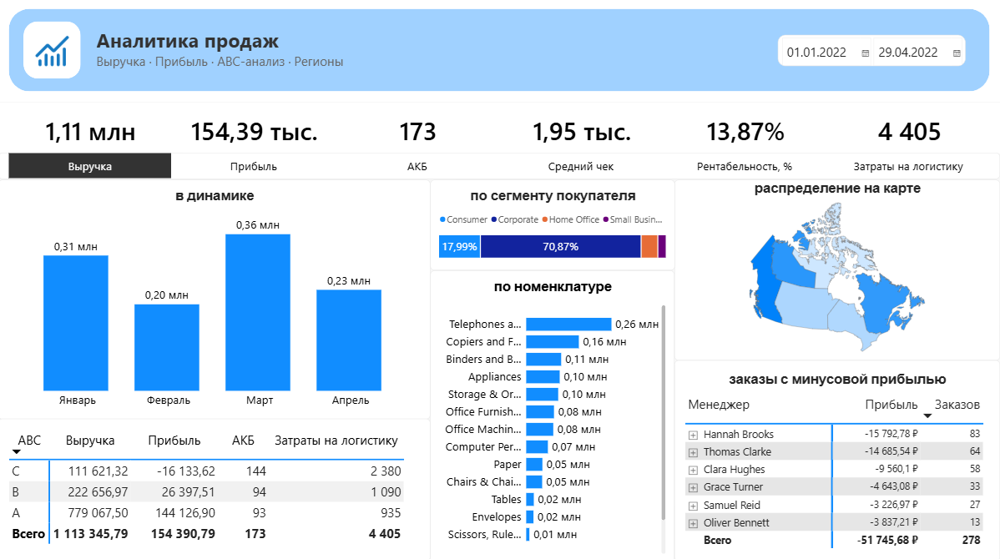

# Аналитика продаж | Power BI

## О проекте

Небольшой портфолио-проект по разработке интерактивного дашборда в Power BI на основе синтетических данных о продажах.

Основная цель — продемонстрировать работу с Power Query, моделированием данных, DAX и визуализацией ключевых бизнес-показателей. Отчёт позволяет анализировать продажи и прибыльность, исследовать товарную номенклатуру, сравнивать показатели по регионам и выявлять убыточные заказы.

Источник данных — Excel-файл, размещённый в этом же репозитории GitHub. Подключение к нему реализовано через интернет.

## Возможности отчёта

- **Ключевые показатели:** выручка, прибыль, рентабельность, активная клиентская база (АКБ), средний чек и затраты на логистику.
- **Динамика показателей:** анализ изменений во времени с детализацией по годам, кварталам, месяцам и дням.
- **Сегментация покупателей:** сравнение показателей по клиентским сегментам.
- **Анализ номенклатуры:** исследование продаж с детализацией от категории и подкатегории до конкретного товара.
- **ABC-анализ:** классификация товаров по накопительной доле выручки с порогами 70% и 90%.
- **Анализ убыточных заказов:** определение заказов с отрицательной суммарной прибылью, группировка по менеджерам и детализация до отдельных заказов.
- **Географический анализ:** интерактивная карта бизнес-регионов Канады на основе собственного картографического слоя TopoJSON.

Для взаимодействия с отчётом предусмотрены фильтрация по датам, переключение анализируемых показателей и перекрёстная фильтрация визуализаций.

## Дашборд



## Технологии

- **Power BI Desktop** — построение модели данных, настройка связей и создание интерактивного дашборда.
- **Power Query (M)** — загрузка и преобразование данных, создание динамического календаря.
- **DAX** — расчёт ключевых показателей, ABC-анализ и анализ убыточных заказов.
- **Excel** — хранение исходных данных и справочников.
- **Mapshaper / TopoJSON** — подготовка картографического слоя для отображения бизнес-регионов Канады.
- **GitHub** — хранение проекта и Excel-файла, используемого как удалённый источник данных.

## Структура репозитория

```text
sales-analytics-powerbi/
├── data/
│   └── sales_data.xlsx        # Данные о продажах и справочники
├── maps/
│   └── canada-regions.json    # Картографический слой TopoJSON
├── powerbi/
│   └── sales-dashboard.pbix   # Отчёт Power BI
├── screenshots/
│   └── dashboard.png          # Скриншот дашборда
└── README.md                  # Описание проекта
```

Исходные данные и справочники хранятся в Excel-файле `data/sales_data.xlsx`. Power BI загружает их напрямую из GitHub через веб-подключение.

Файл `maps/canada-regions.json` содержит географические границы регионов, подготовленные для визуализации на карте.

## Как открыть отчёт

1. Скачайте файл [`sales-dashboard.pbix`](powerbi/sales-dashboard.pbix).
2. Откройте его в **Power BI Desktop**.
3. Для загрузки актуальных данных нажмите **«Обновить»**. Отчёт подключён к Excel-файлу, размещённому в этом репозитории на GitHub.

Отчёт содержит загруженные данные, поэтому для просмотра дашборда обновление не требуется.